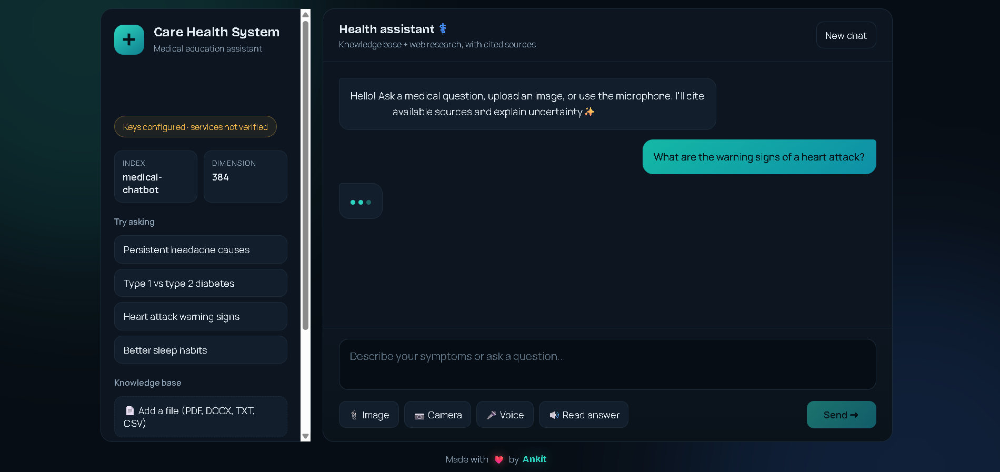

<div align="center">

# ***Care Health System 🩺***
---

### ***🤖 Medical Education Assistant • Knowledge Base + Web Research • Cited Sources***
***Private Medical Knowledge Retrieval • Web Research • Image / Camera / Voice Input • Read-Aloud Answers • Uncertainty-Aware Responses***

<p align="center">

</p>

<p align="center">


</p>

---

### ***🌟 About Care Health System***

***Care Health System is a medical education assistant built on a Retrieval-Augmented Generation (RAG) pipeline. It answers health questions from a curated medical knowledge base, supplements them with web research when needed, and always cites the sources it used while explaining how certain (or uncertain) the answer is.***

***Users can type a question, upload an image, take a photo with the camera, or speak using the microphone, and then have the answer read aloud.***

<p align="center">
<a href="https://care-assistent.onrender.com" target="_blank">

</a>
</p>
</div>

---

### ***🌐 Live Demo***

***Web Application 👉 [Medical Assistent](https://care-assistent.onrender.com)***

---

### ***📸 Project Preview***

<p align="center">

</p>

---

### ***✅ What Care Health System Can Do***

- 💬 Chat-style medical education assistant
- 📚 Answers from a medical knowledge base (vector search)
- 🌐 Web research to supplement the knowledge base
- 🔗 Cited sources with every answer
- ⚠️ Explains uncertainty instead of overclaiming
- 🖼️ Image upload and 📷 camera capture
- 🎤 Voice input (microphone) and 🔊 "Read answer" text-to-speech
- 📄 Add your own files to the knowledge base (PDF, DOCX, TXT, CSV)
- 🧠 Conversation memory
- 🌑 Modern dark-theme interface with a "New chat" button

---

### ***🧠 How It Works***

```text
                 💬 User Input
        (text • image • camera • voice)
                        │
                        ▼
              1. Understand Query
                        │
                        ▼
           2. Embed & Retrieve from KB
                 (Pinecone, 384-dim)
                        │
                        ▼
            3. Check Evidence Quality
                        │
             ┌──────────┴──────────┐
             ▼                     ▼
       Evidence Strong        Evidence Weak
             │                     │
             │                     ▼
             │            4. Web Research
             │                     │
             └──────────┬──────────┘
                        ▼
         5. Generate Answer with Citations
                        │
                        ▼
      Answer + Sources + Uncertainty Note
                        │
                        ▼
              (Optional) 🔊 Read Aloud
```

| Step | Stage | Purpose |
|---|---|---|
| 1 | **Understand query** | Process text, image or transcribed voice input |
| 2 | **Retrieve from KB** | Fetch the most relevant chunks from medical documents |
| 3 | **Check evidence** | Decide whether the retrieved context answers the question |
| 4 | **Web research** | Search the web when the knowledge base is not enough |
| 5 | **Cited answer** | Generate the response from gathered evidence, with sources and uncertainty |

> 📐 Architecture diagram: see [`preview/agent_architecture.png`](./preview/agent_architecture.png)

---

### ***💡 Example Questions***

- *What are the warning signs of a heart attack?*
- *What causes persistent headaches?*
- *What is the difference between type 1 and type 2 diabetes?*
- *How can I improve my sleep habits?*

---

### ***🧩 Tech Stack***

### ***AI & Retrieval***

- **RAG** over medical documents
- **Pinecone** vector index (`medical-chatbot`, 384 dimensions)
- **Sentence-embedding model** (MiniLM, 384-dim)
- **LLM** for answer generation
- **Web search** for supplementary research

### ***Application***

- **Python 3.11**
- **Backend** (`src/agent/backend.py`)
- **Custom dark-theme frontend** (`ui/static`, `ui/template`)

### ***Deployment***

- **Docker**
- **Render**

---

### ***📁 Project Structure***

```text
Care_Health_System/
│
├── preview/
│   ├── agent_architecture.png     # Architecture diagram
│   └── live.png                   # Project UI screenshot
│
├── src/
│   └── agent/
│       ├── __init__.py
│       ├── backend.py             # API routes and request handling
│       ├── config.py              # Configuration and environment settings
│       ├── ingest.py              # Document ingestion into the vector index
│       ├── knowledge.py           # Retrieval and knowledge-base logic
│       └── main.py                # Application entrypoint
│
├── data/                          # Medical knowledge base documents
├── ui/
│   ├── static/                    # CSS, JS, assets
│   └── template/                  # HTML templates
│
├── .dockerignore
├── .env                           # Environment variables (not committed)
├── .gitignore
├── Dockerfile                     # Docker configuration
├── medical_memory*                # Local conversation memory files
├── requirements.txt               # Python dependencies
└── run.py                         # Run the application
```

---

### ***🧪 Why Cited, Uncertainty-Aware Answers Matter***

Health information is high-stakes, so the assistant is designed to be transparent:

```text
Knowledge Base Evidence Found?
          ↓
Evidence Good Enough?
          ↓
   YES → Answer from the knowledge base
   NO  → Research the web
          ↓
Cite sources + state what is uncertain
```

---

### ***⚠️ Limitations***

- Answer quality depends on the quality and coverage of the ingested documents.
- Web research results depend on external search availability and source quality.
- Image understanding is limited and is not a diagnosis.
- Free-tier hosting may have cold starts and non-persistent disk storage.
- LLM, search and vector services require network access and valid API keys.

---

### ***🔮 Future Enhancements***

- Multi-language support
- User accounts and saved chat history
- Evaluation suite for retrieval and answer quality
- Improved medical-image analysis
- Admin dashboard for document management
- Mobile-friendly PWA

---

### ***🎯 Real-World Use Cases***

✔ Patient Education Assistant

✔ Health Information Search

✔ Medical Student Study Aid

✔ Healthcare Knowledge Base Q&A

✔ RAG Demonstration

✔ AI/ML Portfolio Project

---

## ***🧠 Key Learning Outcomes***

1. Build a RAG pipeline with a vector database.
2. Create embeddings and manage a Pinecone index.
3. Ingest PDF, DOCX, TXT and CSV documents.
4. Combine private retrieval with web research.
5. Generate answers with source citations.
6. Handle multimodal input (image, camera, voice) and text-to-speech.
7. Build a custom chat frontend.
8. Package the app with Docker and deploy it on Render.

---

## ***🩺 Medical Disclaimer***

**Care Health System is an educational and demonstration project. It does not provide medical advice, diagnosis or treatment, and it must not replace a qualified healthcare professional. In an emergency (for example, suspected heart attack or stroke), contact your local emergency services immediately.**

---

## ***👨‍💻 Developer***

<div align="center">

# ***ANKIT GUPTA 👦***

### ***AI Engineer • AI Backend Developer • GenAI Developer***

**Building practical AI systems with Python and RAG**

</div>

---

### ***⭐ Support the Project***

If you find Care Health System useful:

- ⭐ Star the repository
- 🍴 Fork the project
- 🐛 Report issues
- 💡 Suggest new features
- 📢 Share the project

---

<div align="center">

### ***Care Health System: Medical Education Assistant 🩺***

***Ask Clearly. Verify Sources. Understand the Uncertainty.***

### ***Built with ❤️ by Ankit***

</div>
